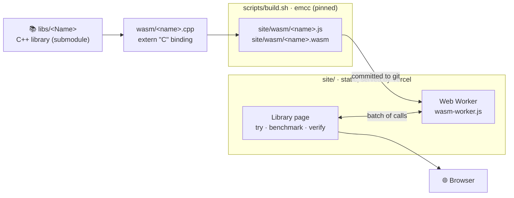
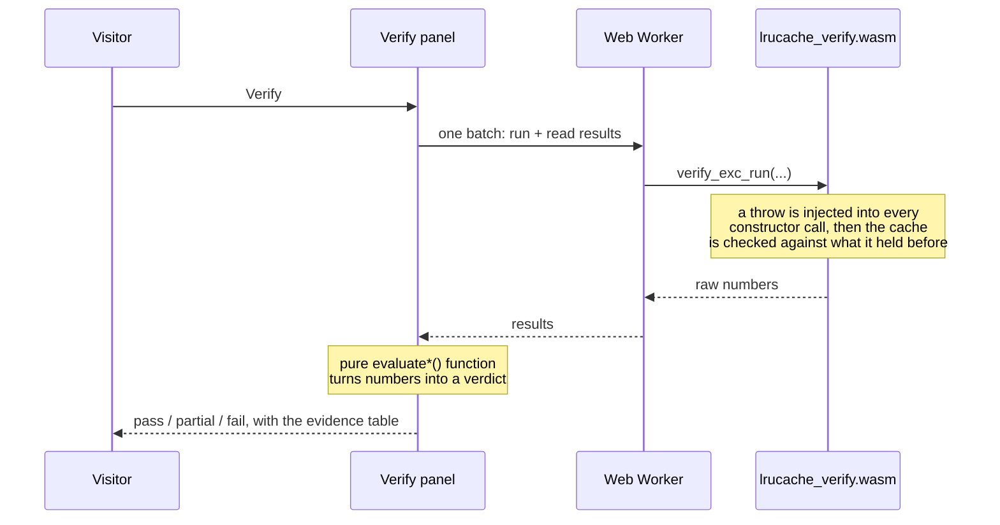

<p align="center">
  
</p>

<p align="center">
  
  
  
  
  
</p>

<p align="center">
  
</p>

<p align="center"><sub><b>CI / CD</b></sub></p>
<p align="center">
  <a href="https://github.com/privateMwb/ProofBench/actions/workflows/ci.yml">
    
  </a>
  <a href="https://github.com/privateMwb/ProofBench/actions/workflows/release.yml">
    
  </a>
</p>

<p align="center"><sub><b>Code Quality &amp; Safety</b></sub></p>
<p align="center">
  <a href="https://github.com/privateMwb/ProofBench/actions/workflows/lint.yml">
    
  </a>
  <a href="https://github.com/privateMwb/ProofBench/actions/workflows/codeql.yml">
    
  </a>
</p>

<p align="center">
  
</p>

<p align="center">ProofBench is a website where C++ libraries <b>prove their own claims</b>. Each library is compiled to WebAssembly and runs live in your browser: you can try it, benchmark it against a plain baseline, and press <b>Verify</b> to check the promises its README makes, such as <i>zero heap allocations</i> or <i>strong exception guarantee</i>. There is no server: it is static files, and every measurement runs on your machine.</p>

<br>

> [!NOTE]
> **Status: in development, not yet tagged.** One library is live (**LRUCache**) with an interactive demo, a
> benchmark and four verified claims; six more are planned. The CI workflows, rulesets and Dependabot config in
> `.github/` were added after the code and **have not run on GitHub yet**: they were checked locally, so treat the
> first run as their first real test. See [Status](#status).

<br>

## 📑 Table of Contents

- [Features](#features)
- [What's Inside](#whats-inside)
- [How It Works](#how-it-works)
- [Requirements](#requirements)
- [Installation](#installation)
- [Quick Start](#quick-start)
- [Adding a Library](#adding-a-library)
- [The Site](#the-site)
- [Project Structure](#project-structure)
- [Development](#development)
- [Continuous Integration](#continuous-integration)
- [Deployment](#deployment)
- [Design Notes](#design-notes)
- [Status](#status)
- [Documentation](#documentation)
- [Contributing](#contributing)
- [Changelog](#changelog)
- [Security](#security)
- [License](#license)

<br>

## <a id="features"></a>✨ Features

- **Runs in your browser** — C++ is compiled to WebAssembly and loaded in a Web Worker, so the page stays responsive while a benchmark runs and nothing is sent anywhere.
- **Try it** — each library page has an interactive demo of the real library, not a re-implementation in JavaScript.
- **Benchmark it** — the library is raced against a textbook baseline with identical keys and operations, in alternating order, with warm-up rounds discarded. Results are medians with the middle-50% range, and overlapping ranges are called a **tie** instead of a win.
- **Verify it** — a claim from the library's README is measured live and judged `pass`, `partial` or `fail`. Allocations are counted with a replaced `operator new`, constant time is shown by counting hash and comparison calls instead of trusting a clock, and exception safety is tested by injecting a throw at every constructor call.
- **Honest about limits** — timings are WebAssembly in a browser, not native speed, and browsers round their timers on purpose. The pages say so.
- **Verdicts are pinned by tests** — `tests/lrucache.verify.test.mjs` fixes the expected verdict of each claim, so a regression (or a fix) has to be acknowledged in a commit.
- **Reusable panels** — the benchmark panel and the verify panel are libraries of their own; a new library page is mostly configuration.
- **No runtime dependencies** — static files, no third-party scripts, fonts or network loads. Node is only needed for the tests and the linter.
- **Built files are committed** — Vercel can't compile C++, so it serves exactly what is in git, and CI fails if a built file is missing.

<div align="right"><a href="#-table-of-contents"></a></div>

## <a id="whats-inside"></a>📚 What's Inside

| Library | Status | What it claims |
|---|:-:|---|
| [**LRUCache**](https://github.com/privateMwb/LRUCache) | ✅ live | Fixed-capacity LRU cache with O(1) get, put and erase and zero steady-state heap allocations. |
| **HashMapPro** | 🔜 planned | Separate-chaining hash map with automatic rehashing. |
| **VectorPro** | 🔜 planned | `std::vector`-like array with a configurable growth policy. |
| **JsonParser** | 🔜 planned | RFC 8259 parser with a nesting-depth guard. |
| **DnsResolver** | 🔜 planned | RFC 1035 packets, with compression-loop protection. |
| **RaftCore** | 🔜 planned | Raft leader election and log replication on a simulated network. |
| **ArenaAllocator** | 🔜 planned | Bump-pointer arena with nested rollback frames. |

**LRUCache's four verified claims**

| Claim | How it is checked |
|---|---|
| Zero heap allocations in steady state | Four workloads run with a counting `operator new`; the baseline's count is shown beside it |
| Constant work per operation | Hash and key-comparison calls per operation, from 100 to 300,000 entries |
| Strong exception guarantee on insert | A throw is injected into every constructor call, with room and when the insert has to evict |
| Exact hit and miss statistics | Counts compared with a reference model; peeks must not touch them, `resetStats()` must clear them |

<div align="right"><a href="#-table-of-contents"></a></div>

## <a id="how-it-works"></a>🧠 How It Works

C++ is compiled once, ahead of time. The built files are committed, and the browser does the rest.



What happens when a visitor presses **Verify**:



The module conventions, the worker protocol and the panels are written up in [docs/ARCHITECTURE.md](docs/ARCHITECTURE.md).

<div align="right"><a href="#-table-of-contents"></a></div>

## <a id="requirements"></a>📋 Requirements

- Node.js 20 or newer, for the tests and the linter (CI uses 20 for the build and tests, 22 for lint)
- Git, with submodule support
- Python 3, only for `scripts/serve.py`; any static file server works instead
- *(Only to rebuild the WebAssembly)* the pinned Emscripten, **3.1.74** (see `.emscripten-version`)
- A modern browser with WebAssembly and module workers to use the site

You do **not** need Emscripten to run the site or the tests: the built files are committed.

## <a id="installation"></a>📦 Installation

```bash
git clone --recurse-submodules https://github.com/privateMwb/ProofBench.git
cd ProofBench
npm ci
```

Forgot `--recurse-submodules`? Run `git submodule update --init`.

**Installing Emscripten, to rebuild the WebAssembly**

<details>
<summary><b>Windows (PowerShell)</b></summary>

```powershell
# One time
git clone https://github.com/emscripten-core/emsdk.git C:\emsdk
cd C:\emsdk
.\emsdk install 3.1.74
.\emsdk activate 3.1.74

# Every new PowerShell window
C:\emsdk\emsdk_env.ps1
```

</details>

<details>
<summary><b>Linux / macOS</b></summary>

```bash
git clone https://github.com/emscripten-core/emsdk.git ~/emsdk
~/emsdk/emsdk install 3.1.74
~/emsdk/emsdk activate 3.1.74

# Every new shell
source ~/emsdk/emsdk_env.sh
```

</details>

<div align="right"><a href="#-table-of-contents"></a></div>

## <a id="quick-start"></a>🚀 Quick Start

```bash
python scripts/serve.py      # http://localhost:8000
```

Open <http://localhost:8000> and choose **LRUCache**. To change the C++ and see it in the browser:

```bash
# Linux / macOS
./scripts/build.sh
```

```powershell
# Windows (PowerShell)
.\scripts\build.ps1
```

```bash
npm test      # runs every test against the built WASM
```

Then **commit the rebuilt files in `site/wasm/`** along with your change. See [Deployment](#deployment) for why.

<div align="right"><a href="#-table-of-contents"></a></div>

## <a id="adding-a-library"></a>➕ Adding a Library

1. `git submodule add <url> libs/<Name>`
2. Write `wasm/<name>.cpp` with a small `extern "C"` API. Optionally add `wasm/<name>_bench.cpp` and `wasm/<name>_verify.cpp`.
3. Add `site/<name>/index.html` and `site/js/<name>.js`, then an entry in `site/js/libraries.js`.
4. Build, test, and commit `site/wasm/`.

`scripts/build.sh` compiles every `wasm/*.cpp` and puts every `libs/*/include` on the include path, so there is nothing to register. The full walkthrough, with the conventions and a checklist, is in [docs/ADDING_A_LIBRARY.md](docs/ADDING_A_LIBRARY.md).

<div align="right"><a href="#-table-of-contents"></a></div>

## <a id="the-site"></a>🖥️ The Site

| Page | What it is |
|---|---|
| `/` | Landing page: one card per library from `site/js/libraries.js`, marked live or soon |
| `/lrucache/` | **Try it** (an interactive cache and a hit-rate workload runner), **Benchmark it** (against `std::list` + `std::unordered_map`) and **Verify it** (the four claims above) |

Plain HTML, CSS and ES modules; it follows the visitor's light or dark preference. Everything is relative-URL and static, so it works under any path.

<div align="right"><a href="#-table-of-contents"></a></div>

## <a id="project-structure"></a>🗂️ Project Structure

```
ProofBench/
├── libs/                    C++ libraries as git submodules (LRUCache)
├── wasm/                    one binding per module
│   ├── hello.cpp              toolchain smoke test
│   ├── lrucache.cpp           interactive demo
│   ├── lrucache_bench.cpp     benchmark module
│   └── lrucache_verify.cpp    verification module (C++ exceptions, counting operator new)
├── bench/                   header-only harness and the shared baseline LRU
├── site/                    the static frontend, served by Vercel
│   ├── index.html, css/       landing page and styles
│   ├── lrucache/              the LRUCache page
│   ├── js/                    page scripts, worker layer, benchmark and verify panels
│   └── wasm/                  built modules, committed
├── tests/                   Node tests that load the built WASM
├── scripts/                 build.sh, build.ps1, check-wasm.mjs, serve.py
├── docs/                    ARCHITECTURE, ADDING_A_LIBRARY, DEPLOYMENT
├── .github/                 workflows, rulesets, Dependabot, CODEOWNERS, README assets
├── .emscripten-version      the pinned Emscripten
└── vercel.json              build command and output directory
```

<div align="right"><a href="#-table-of-contents"></a></div>

## <a id="development"></a>🛠️ Development

```bash
npm run check    # every wasm/*.cpp has a built module in site/wasm/
npm run lint     # oxlint, warnings are errors in CI
npm test         # the Node tests, against the built WASM
npm run verify   # all three
```

The tests, in the order CI runs them:

| Test | What it covers |
|---|---|
| `tests/smoke.mjs` | The toolchain works: a trivial module loads and returns correct values |
| `tests/lrucache.test.mjs` | LRUCache behaviour through the binding |
| `tests/lrucache.fuzz.mjs` | Differential fuzz: 240,000 random operations against a reference LRU |
| `tests/lrucache.bench.test.mjs` | The benchmark module |
| `tests/bench-stats.test.mjs` | The statistics helpers (quantiles, tie detection) |
| `tests/lrucache-claims.test.mjs` | The pure claim evaluators |
| `tests/lrucache.verify.test.mjs` | The real verification run, with each claim's expected verdict pinned |
| `tests/rulesets.test.mjs` | Required status checks in `.github/rulesets/` match workflow job names |

<div align="right"><a href="#-table-of-contents"></a></div>

## <a id="continuous-integration"></a>🔁 Continuous Integration

Each workflow has a named job, so a failure says exactly which rule broke. The two marked **required** are what the branch ruleset in `.github/rulesets/main-protection.json` asks for; a second ruleset, `release-tags.json`, protects `v*` tags.

| Workflow | Runs on | What it checks |
|---|---|---|
| **CI** | push to `main`, pull requests | Builds every module with the pinned Emscripten, fails if a built file is not committed, then runs the Node tests — **required** (*Build WASM and test*) |
| **Lint** | push to `main`, pull requests | oxlint with warnings denied — **required** (*Lint (oxlint)*) |
| **CodeQL** | push to `main`, pull requests, weekly | Security analysis of the JavaScript |
| **Release** | `v*` tags, manual | Verifies the tree, zips `site/` and creates a GitHub Release |

Dependabot keeps GitHub Actions, the npm dev tooling and the `libs/` submodules current.

<div align="right"><a href="#-table-of-contents"></a></div>

## <a id="deployment"></a>☁️ Deployment

The site is the `site/` folder, served by Vercel. `vercel.json` sets `outputDirectory` to `site` and runs `node scripts/check-wasm.mjs` as the build command.

> [!IMPORTANT]
> **Vercel doesn't compile C++.** It serves what is committed, so after any change to `wasm/`, `bench/` or a library, rebuild and **commit `site/wasm/`**. CI fails with "built but not committed" if you forget, and the Vercel build fails if a `wasm/*.cpp` has no built module.

```bash
# Releases: tag a version and push the tag
git tag v0.5.0 && git push origin v0.5.0     # release.yml attaches proofbench-site-<tag>.zip
```

Any static host works if it serves `.wasm` as `application/wasm` and `.js` as a JavaScript MIME type. Updating a library, changing the Emscripten version and the repository settings the files cannot switch on (rulesets, private vulnerability reporting, Dependabot alerts) are covered in [docs/DEPLOYMENT.md](docs/DEPLOYMENT.md).

<div align="right"><a href="#-table-of-contents"></a></div>

## <a id="design-notes"></a>🔬 Design Notes

**Key decisions**

- **Built WebAssembly is committed.** It is build output, but Vercel can't compile C++, so committing it is what makes the site deployable. The cost is binary diffs, which CI pays for by rebuilding and refusing untracked output.
- **Verdicts come from pure functions.** The C++ produces raw numbers; a JavaScript `evaluate*` function judges them, so the judging logic is unit-tested without a browser, and a claim can be `partial` with the exact failing case shown.
- **Counts, not clocks, for complexity.** "O(1)" is checked by counting hash and comparison calls across sizes from 100 to 300,000, which doesn't depend on how fast the machine or the browser's timer is.
- **A tie is a result.** If the middle-50% ranges of two benchmarks overlap, the panel says there is no clear winner rather than naming one on noise.
- **The baseline gets its best case.** `std::list` + `std::unordered_map` is given `reserve(capacity)` up front so it never rehashes; beating it means something.
- **Libraries stay separate.** Each library is its own repository and a submodule here, and bindings use only its public API, so a page exercises the library the way a user would.
- **One pinned toolchain.** `.emscripten-version` is read by the build scripts and by CI, so everyone compiles with the same Emscripten.

**Known limits** — timings are WebAssembly in a browser, not native speed. Only LRUCache is live. CI rebuilds the WASM but does not compare the rebuilt bytes with the committed ones, so a committed binary is trusted to match its source (see [SECURITY.md](SECURITY.md)).

<div align="right"><a href="#-table-of-contents"></a></div>

## <a id="status"></a>🗺️ Status

- [x] Phase 1: toolchain, CI, deploy
- [x] Phase 2: LRUCache page (try it)
- [x] Phase 3: benchmark harness (LRUCache vs `std::list` + `std::unordered_map`)
- [x] Phase 4: verify-the-claim panels (LRUCache: allocations, O(1), exceptions, statistics)
- [ ] Phase 5: more libraries
- [ ] Phase 6: polish

<div align="right"><a href="#-table-of-contents"></a></div>

## <a id="documentation"></a>📖 Documentation

| Document | What's inside |
|---|---|
| [docs/ARCHITECTURE.md](docs/ARCHITECTURE.md) | The pipeline, module conventions, the worker layer, the benchmark and verify panels, the tests |
| [docs/ADDING_A_LIBRARY.md](docs/ADDING_A_LIBRARY.md) | A step-by-step guide to adding a library, with a checklist |
| [docs/DEPLOYMENT.md](docs/DEPLOYMENT.md) | Vercel, CI, updating a library, changing Emscripten, releases and repository settings |
| [CONTRIBUTING.md](CONTRIBUTING.md) | Setup, the checks to run and the pull request flow |
| [SECURITY.md](SECURITY.md) | What is in scope and how to report a vulnerability |
| [CHANGELOG.md](CHANGELOG.md) | Notable changes |

<div align="right"><a href="#-table-of-contents"></a></div>

## <a id="contributing"></a>🤝 Contributing

Issues and pull requests are welcome. [CONTRIBUTING.md](CONTRIBUTING.md) covers setup, running the checks and the submodule flow. In short:

- Rebuild the WASM and **commit `site/wasm/`** whenever you change `wasm/`, `bench/` or a library
- Fix a library in **its own repository** first, then update the submodule pointer here
- Run `npm run verify` before opening a pull request: CI enforces it
- Don't add third-party scripts or network loads, and set text rather than HTML

<div align="right"><a href="#-table-of-contents"></a></div>

## <a id="changelog"></a>📝 Changelog

Notable changes are recorded in [CHANGELOG.md](CHANGELOG.md); release notes are published on the [Releases](https://github.com/privateMwb/ProofBench/releases) page once a version is tagged.

<div align="right"><a href="#-table-of-contents"></a></div>

## <a id="security"></a>🔒 Security

Please don't report a suspected vulnerability in a public issue. Use GitHub's private reporting instead: this repository's **Security** tab, then **Report a vulnerability**, so it can be fixed before it's disclosed. Details are in [SECURITY.md](SECURITY.md).

> [!WARNING]
> The site serves **committed binaries**. CI rebuilds them from source but does not compare the bytes, so review changes
> to `site/wasm/` with the same care as source changes.

<div align="right"><a href="#-table-of-contents"></a></div>

## <a id="license"></a>📄 License

MIT — see [LICENSE](LICENSE) for details.

<p align="center">
  
</p>

<p align="center">
  <sub>C++ compiled to WebAssembly, served as plain HTML, CSS and JavaScript</sub>
</p>

<p align="center">
  <a href="#-table-of-contents"></a>
</p>
